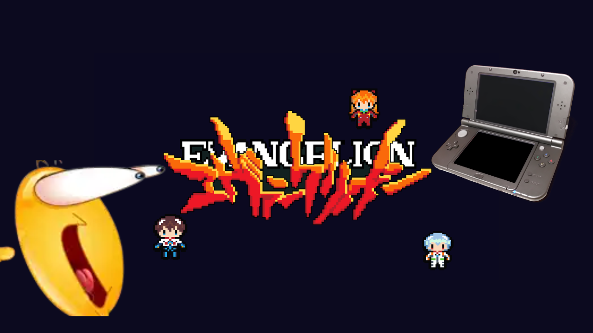

# evangelion-angel-attack

An Evangelion inspired fan-game for the Nintendo 3DS

---

---

This project is in active development and is not finished. I work on this project in my free time. It is written completely in C. All pixel art is made in Aseprite. I've yet to find any good software for making music.

The game is supposed to work on old and new models. I've only tested the game in an emulator as I am waiting to finish the game to test it on my actual hardware.

I post updates on my YouTube channel: https://youtube.com/@ShadowNetter

## AI Usage

AI is only used to locate errors in the code when they show up. AI is NOT used to generate code nor art.

## Gameplay

In evangelion-angel-attack you play as either Shinji, Asuka or Rei and face several angels in Undertale-style battles. You can choose different abilities and earn Level Points to upgrade your stats and unlock new abilities.

## Progress
- [ ] Add audio
- [x] Title screen
- [ ] Create proper Makefile
- [x] Options menu
- [x] Pilot selection menu
- [x] Stats menu
- [x] Abilities menu
- [x] Mastery menu
- [x] Skins menu
- [ ] Actual game part of the game

---

## Credits

cJSON library (used for interacting with the JSON save file): https://github.com/DaveGamble/cJSON.git